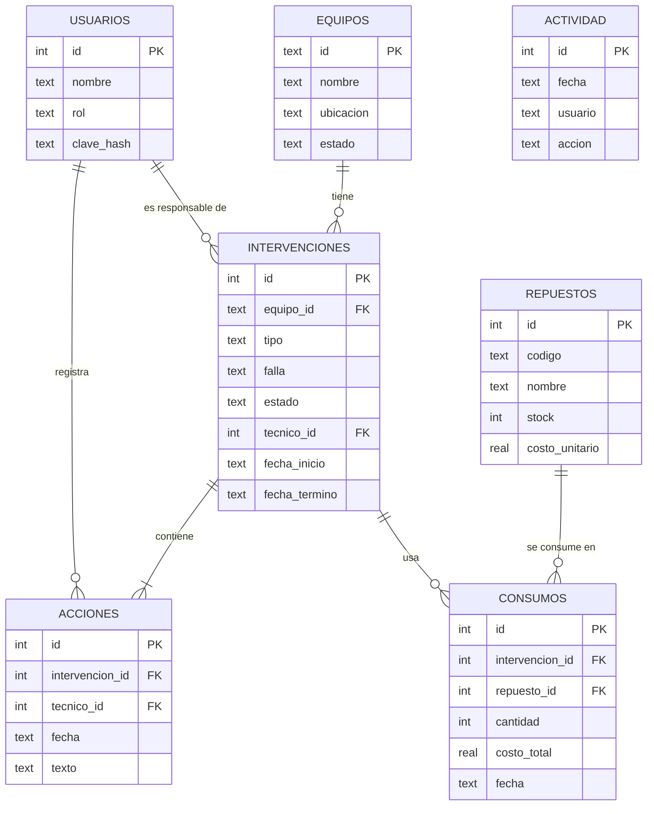

# Diseño de la base de datos (SQLite)

| Tabla | Uso | Sprint |
|---|---|---|
| usuarios | Personal con rol (técnico, supervisor, bodega, jefatura) y clave con hash | 1 |
| equipos | Catálogo de máquinas con código único y estado activo/inactivo | 1 |
| intervenciones | Falla, tipo, estado, técnico responsable y fechas | 1 |
| acciones | Acciones de cada intervención, con técnico y fecha (permite continuar en otro turno) | 1 |
| actividad | Registro de accesos, cambios e intentos no autorizados | 1 |
| repuestos y consumos | Stock, costos y repuestos usados por intervención | 2 |

## Reglas de negocio aplicadas en la base de datos
- El estado de un equipo solo puede ser `activo` o `inactivo` (por defecto `activo`).
- Una intervención no puede cerrarse sin fecha de término.
- Stock y costos no pueden ser negativos, y la cantidad consumida debe ser mayor que 0.
- El historial (intervenciones, acciones y consumos) no se puede borrar.
